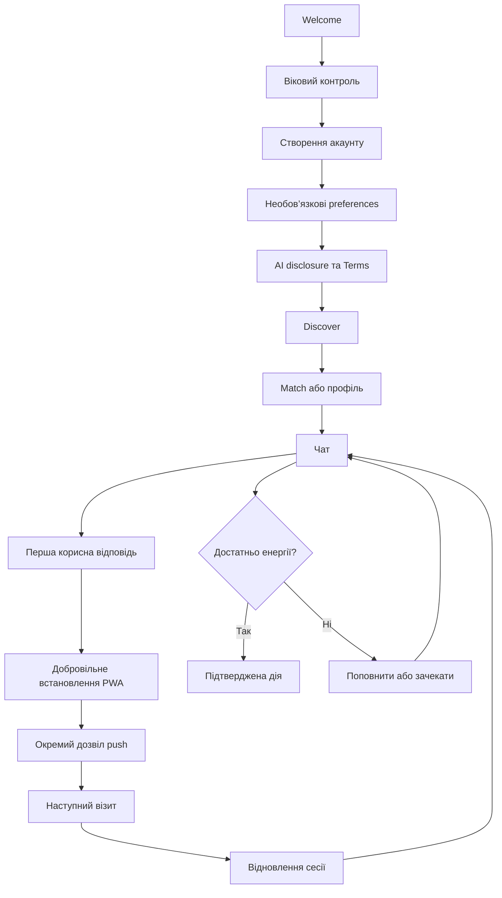

# 05. Користувацькі сценарії

Позначення екранів відповідають [каталогу S01–S45](04-screen-specification.md). Основна ціль: швидко дійти до якісної розмови й зберегти її контекст при наступному візиті. Нижче описані **рекомендовані сценарії**, а не вже реалізована поведінка.

## Загальна карта

Схема стислива: sensitive consent, посилена перевірка віку й регіональна доступність застосовуються до залежних дій, навіть якщо окремо не намальовані. Після повернення opening route може бути іншим, ніж чат.

## F01. Новий користувач → перша цінність

**Вхід:** рекламне/органічне посилання, без сесії. **Успіх:** користувач розуміє AI-природу сервісу та отримав першу відповідь.

1. S01: коротке позиціонування → «Почати».
2. S02: DOB; якщо потрібно — S41. До результату немає захищеного контенту.
3. S03 → S04: email-код або підтримуваний OAuth.
4. S05: nickname; гендер/preferences можна пропустити. Sensitive-дані не зберігати до S07 за потреби.
5. S06: свідомий AI acknowledgment і окреме прийняття Terms/Privacy acknowledgment. Backend записує версії.
6. S08: сітка персонажів із фільтрами; ♥ або S10 → S13.
7. Перше повідомлення кожного чату — сірий AI-дисклеймер у стрічці. Якщо чат потребує додаткової правової підстави — S07 до першої обробки.
8. Користувач пише/обирає підказку, бачить 1 ⚡, надсилає; отримує відповідь.

**Відхилення:** неповнолітній → S45; OAuth скасовано → S03; код прострочився → resend; optional відмова → без персоналізації; не прийняті обов’язкові умови → без Discover, legal/help доступні. Cookie-вибір, якщо потрібен, не дозволяє запускати трекери до consent і не створює чергу popups поверх першої розмови.

**Критерій:** оновлення сторінки на кожному кроці повертає до актуального незавершеного кроку, а не створює дубль акаунту. Install/push/paywall не вклинюються до першої цінності без потреби користувача.

## F02. Повторний вхід і відновлення акаунту

**Вхід:** прямий запуск, PWA, push або bookmark. **Успіх:** той самий account_id, баланс та історія.

S25 перевіряє серверну сесію → чинна: відновити route → оновити баланс/unread. Якщо сесія потребує refresh — один узгоджений refresh, без Welcome-flash. Offline/5xx → S43 зі збереженням auth-контексту. Лише підтверджений auth failure → S03/S04 → відновлення безпечного return route.

При іншому способі входу не зливати акаунти лише за клієнтським email. Для recovery без доступу до email — підтримка й перевірений процес; не видавати історію за nickname або квитанцією без достатнього доказу володіння. Обмежений акаунт → S45.

**Критерій:** користувач не втрачає куплену енергію після очищення cookie, перевстановлення PWA або входу на іншому пристрої; ці дані серверні. Сама сесія після очищення даних закономірно може вимагати нового входу.

## F03. Discover → match → чат

S08 (сітка) → за потреби звузити вибір чіпами інтересів на сторінці або в S09 (гендер, вік, раса, стиль спілкування, «Лише нові») → тап по картці → S10 → «Почати чат»; або одразу ♥ на картці → S13 без проміжного екрана. У запропонованій MVP-механіці доступний персонаж не потребує очікування «згоди реальної людини»: сервер створює ігровий match/діалог з історією «AI-дисклеймер → стікер ♥ → привітання персонажа». Back із чату повертає S08 зі збереженими фільтрами, розмова зберігається в S12.

Pass немає: персонаж, з яким користувач не взаємодіє, просто лишається в сітці. У персонажа з розмовою кнопка ♥ замінюється на 💬 — повторна дія відкриває існуючий діалог. Нуль результатів → «Скинути фільтри» на S08 або зміна фільтрів у S09. Ініціативна симпатія від сценарію може з’явитися у S12 лише як справжня зафіксована ігрова подія, без заяви про людський інтерес.

**Критерій:** жодна дія не потребує жесту; фільтри переживають повернення з профілю/чату й перезапуск; історія діалогу не дублюється.

## F04. Надсилання тексту та AI-відповідь

**Передумови:** дозволений доступ/обробка, видима ціна 1 ⚡. Suggested reply лише заповнює поле.

1. Tap Send створює стабільний `client_message_id`; UI показує pending bubble.
2. Сервер атомарно перевіряє баланс і резервує 1; повтор того самого ID не резервує ще раз.
3. Accepted запускає AI-відповідь; індикатор підготовки, можливе потокове відображення.
4. Успішне завершення — остаточне списання й фінальний статус.
5. Визначена технічна помилка/модераційна відмова до придатного результату — резерв повертається за рекомендованою політикою MVP.

**Невідомий результат:** спершу status lookup, потім retry з тим самим ID. **Недостатньо:** S20, текст залишається. **Обрив зв’язку:** не вирішувати локально, що гроші/енергія повернуті; звіритися з ledger. **Часткова генерація:** запропоновано відновлювати ту саму відповідь без доплати; якщо не вдалося завершити — повернути резерв. Цю політику затвердити до релізу.

**Критерій:** подвійний tap, refresh і два мережеві retry дають одне повідомлення та одне списання. Отримання наступних ініціативних відповідей не списує енергію.

## F05. Вихідні та вхідні медіа

**Voice:** S13 → S14/S15 → системний permission після дії → recording → preview → явно priced send → processing → bubble. Permission denied → інструкція/текстова альтернатива. Cancel/delete preview — без списання.

**Upload photo:** S14 → picker/camera → S16 → preview/caption → send → upload/moderation → bubble. При нестачі енергії зберігати intent; після тривалої оплати браузер може втратити локальний File, тоді чесно попросити повторний вибір, а не показувати фальшиве «надіслано».

**Sticker/emoji:** S17 → вибір → composer/preview → підтвердження з тарифом. Реакція — безкоштовна за пропозицією MVP.

**Вхідні:** серверна подія → S12 unread/S13 bubble → добровільний playback/view S18. Отримання, перегляд і повторне відкриття вже доставленого медіа — 0 ⚡; без autoplay. Спонтанне AI-фото не запускає приховане списання за генерацію.

**Критерій:** усі п’ять форматів працюють у двох напрямках; кожен вихідний платний тип має видиму ціну до Send.

## F06. Запит нового AI-фото

S13 → S14 «Створити AI-фото · 10 ⚡» → короткий review запиту/дозволеного стилю → «Створити за 10 ⚡». Не генерувати на тап по thumbnail. Сервер перевіряє age/content/access і атомарно резервує 10. При дефіциті → S20.

Job має стабільний ID і стани queued / running / completed / failed / blocked. Показується реальний статус без вигаданого прогресу. Користувач може закрити екран; job лишається на сервері, результат повертається в той самий чат. При success — модерація/маркування → bubble/S18 → списання. При технічній невдачі або відхиленому результаті — release резерву. Cancel можливий до запуску, якщо підтримується; після запуску не показувати неправдиве «скасовано».

**Критерій:** після refresh або повернення з PWA видно той самий job. Повторне відкриття фото безкоштовне; нова генерація — нова явно підтверджена дія.

## F07. Нестача енергії → покупка → продовження

S20 показує дефіцит і час відновлення → S19/конкретний review → S22. Якщо користувач обирає чекати, sheet закривається, чернетка зберігається; відновлення автоматичне за server time. Не вимагати залишати сторінку відкритою.

У checkout створюється purchase intent із типом продукту, сумою та return destination. Після 3DS/оплати backend підтверджує транзакцію; pending не дорівнює failed. Тільки після verified success нарахувати енергію один раз. «Повернутися до розмови» → S13 із чернеткою. Надіслати/генерувати користувач підтверджує сам.

**Відхилення:** скасування/відмова → назад без втрати контексту; інша вкладка/PWA → reconciliation за account/order ID; webhook після закриття → баланс оновиться наступного входу; дубль webhook → без подвійного credit.

**Критерій:** жодна невизначена оплата не викликає автоматичний повторний платіж. Є support reference й доступна квитанція.

## F08. Добровільна покупка VIP

S19 або S26 → S21 → порівняння/ціна/період/recurring → S22 → verified subscription state → S30. Нові параметри енергії застосовуються з визначеного серверного моменту. Зміна плану не створює одноразовий невказаний бонус.

Existing VIP відкриває керування, а не дублюючу підписку. Failed/pending не показує active. У тексті пояснено: VIP підвищує відновлення/ліміт, але не скасовує тарифи 1/10.

## F09. Корисний досвід → PWA → push

**Гіпотеза тригера:** перша завершена змістовна розмова або другий візит. Не під час набору, генерації, checkout чи юридичного підтвердження.

S23 → iPhone instructions або підтримуваний Android install prompt → користувач додає застосунок → запуск з іконки → S25. Виявлений standalone-launch підтверджує результат, натискання «Готово» саме по собі — ні.

Після успішного повернення в акаунт S24 пояснює push → tap → browser permission → subscription → backend registration → готово. На Android push може працювати й без встановлення; не видавати install за універсальну технічну умову. На iPhone використовувати підтримуваний home-screen режим.

**Відмова:** «Не зараз» прибирає пропозицію; гіпотеза cooldown — 7 днів для install і 14 днів для власного push-пояснення. Системний denied не перепитувати циклічно. Settings дає ручний повтор. Недоступна платформа → browser-only experience.

## F10. Повернення через push

Реальна актуальна подія → перевірка category/quiet hours/частоти/блокування → приватний push → tap → scoped route у потрібному браузері/PWA → S25 → перевірка доступу до chat/message → S13.

Expired/revoked session → F02, потім цільовий чат. Видалене повідомлення/прихований персонаж → S12 або S45 із поясненням. У push/URL немає access token або інтимного тексту. Відкритий чат не отримує зайвий re-engagement push. Лічильник і unread синхронізуються серверно.

## F11. Вихід із браузера / offline / нова версія

При згортанні не розраховувати на безперервний timer, websocket або background job клієнта. На resume: перевірити сесію → отримати стан jobs, ledger і unread → продовжити на місці.

Offline: доступний shell/пояснення; не виконувати paid sends. Чернетка лишається у пам’яті активного контексту; довготривале локальне зберігання інтимних чернеток — лише свідоме окреме рішення. Після reconnect — синхронізація, потім явний send користувача.

Нова версія PWA → ненав’язливе «Доступне оновлення» після безпечної точки. Не робити forced reload під час запису аудіо або оплати. Старі API/jobs мають погоджений перехідний період сумісності.

## F12. Зміна приватності / відкликання згоди

S26 → S32 → конкретна мета → пояснення наслідків → підтвердження → server update → припинення залежної обробки. Preference відмови не змінює Terms acceptance чи push permission автоматично. Нову personalization не запускати без активної підстави.

Training OFF зупиняє майбутнє використання відповідно до договорів і процесів; не обіцяти миттєве «забуття» вже навченою моделлю, якщо цього немає. Запит видалення похідних даних → S36/S35/support. Відсутність згоди не запускає repeated nagging.

## F13. Скасування VIP / refund

S26 → S30 → S31 → пояснення дати закінчення → «Скасувати автоподовження» → provider/server confirmation → canceled-but-active до визначеної дати. Немає обов’язкового дзвінка, чату з оператором чи анкети причини.

Refund окремо: S44 → вибрана покупка → «Проблема/повернення» → умови й причина → request ID → статус. Не змішувати cancel future renewal із поверненням минулого платежу. При затримці провайдера — pending, не false success.

## F14. Видалення чату / акаунту

**Чат:** S13 menu → S36 → визначити delete vs restart → підтвердження → очищення історії/пам’яті за політикою → S12. Block для припинення ініціатив — окрема дія.

**Акаунт:** S26/S32 → S37 → optional export → підтвердження особи → пояснення balance/billing/retention → final delete → зупинення renewal → відкликання сесій/push → процес очищення → підтвердження. Якщо billing не завершено, це видимий pending із зверненням; не приховувати від користувача.

**Критерій:** після видалення немає нових push, платних renewal або доступу через старі сесії. Законно збережені транзакційні записи обмежені й відокремлені від видалених чатів.

## F15. Небажана відповідь → report / block

Bubble menu або profile menu → S38 → причина → preview фрагментів → submit → reference. Додатково «Приховати персонажа» → припинення ініціативних подій і push → S12/S08. Скарга безкоштовна незалежно від балансу.

Якщо користувач просто робить reset, це не замінює report. При помилці submit є retry без дублювання звернення. Серйозний content incident має внутрішню ескалацію; звичайний UI не обіцяє конкретний результат розгляду за відсутності процесу.

## F16. Оновлені Terms / нова правова мета

S25/фоновий server status визначає потрібне підтвердження → S42 → короткий зміст/reader → конкретна дія → versioned record → повернення на попередній route. Не перепитувати через кожен запуск при вже зафіксованій версії.

Відмова може обмежувати майбутнє користування залежно від умов, але не закриває legal, support, cancel subscription або data rights. Зміна Privacy без нової consent-потреби може бути notice, а не обов’язковий checkbox.

## F17. Запит копії даних

S32 → S35 → пропорційна перевірка → запит → preparing → готовий захищений download → expired за строком. Email повідомляє про готовність, а не містить відкриту інтимну історію. Повторний запит не розкриває чужі дані; логування без raw contents. Помилка або частковий export має пояснення й support.

## F18. Недоступна країна / провайдер / заблокований акаунт

Server capability визначає недоступність до купівлі або генерації → S45. Показати конкретне обмеження: весь сервіс, лише adult-контент, лише оплата або тимчасовий збій. Не пропонувати обхід країни чи вікового контролю.

Якщо користувач має кошти/план, доступ до status, звернення й застосовних прав зберігається. При технічній недоступності AI не списувати енергію за невиконану дію. Відновлення сервісу повертає звичайний маршрут без повторного onboarding.
